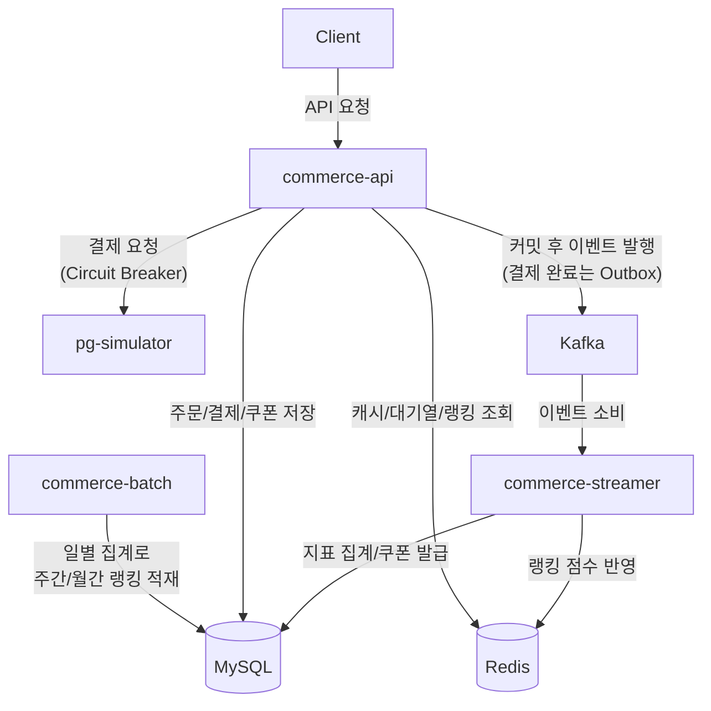

# Loopers Commerce

**Java 21 / Spring Boot 3.4 / JPA + QueryDSL / MySQL / Redis / Kafka / Spring Batch / Resilience4j**

## 목표

- 대규모 트래픽 상황에서 장애와 동시성 문제가 발생해도 유연하게 처리가 가능한 아키텍처를 만들기
- 각 상황마다에서 선택한 트레이드 오프를 논리적으로 설명할 수 있는, 스스로 생각하는 힘을 기르기

## 전체 구조



| 모듈 | 역할 |
|---|---|
| `commerce-api` | REST API (회원/상품/좋아요/쿠폰/주문/결제/대기열/랭킹) |
| `commerce-streamer` | Kafka Consumer (지표 집계, 실시간 랭킹, 선착순 쿠폰) |
| `commerce-batch` | 주간/월간 랭킹 집계 |
| `pg-simulator` | 지연/실패를 흉내 내는 외부 PG |

## 고민한 것들

| 주차 | 고민 | 글 |
|---|---|---|
| 3 | 애그리거트 경계를 어떻게 나누고, N+1은 어디서 책임질까 | [#6](https://github.com/Hwasowl/loop-pack-be-l2-vol4-java/issues/6) |
| 4 | 같은 동시성 문제인데 재고/쿠폰/좋아요의 락은 왜 달라야 할까 | [#7](https://github.com/Hwasowl/loop-pack-be-l2-vol4-java/issues/7) |
| 5 | 조회를 위해 추가한 인덱스가 왜 쓰기의 병목이 됐을까 | [#11](https://github.com/Hwasowl/loop-pack-be-l2-vol4-java/issues/11) |
| 6 | PG가 죽지도 않았는데 서킷은 왜 열려야 할까 | [#13](https://github.com/Hwasowl/loop-pack-be-l2-vol4-java/issues/13) |
| 7 | 어떤 이벤트는 유실되면 안 되고, 어떤 건 괜찮을까 | [#19](https://github.com/Hwasowl/loop-pack-be-l2-vol4-java/issues/19) |
| 9 | 랭킹은 언제부터 언제까지 세야 할까 | [#20](https://github.com/Hwasowl/loop-pack-be-l2-vol4-java/issues/20) |
| 10 | 누적 데이터로 "지난 7일" 랭킹을 어떻게 만들까 | [#17](https://github.com/Hwasowl/loop-pack-be-l2-vol4-java/issues/17) |

## 실행

```shell
docker-compose -f ./docker/infra-compose.yml up
```
